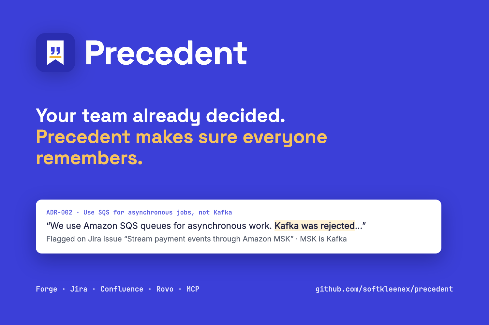

<p></p>

# Precedent

**Your team already decided. Precedent makes sure people — and coding agents — remember.**

[](https://youtu.be/pyH4quHDx8k)

▶ **[Watch the 2:45 demo on YouTube](https://youtu.be/pyH4quHDx8k)** · [Devpost](https://devpost.com/software/precedent-k4ruoc)

Teams record decisions in Confluence: ADRs, design docs, meeting notes. Then a new Jira issue proposes MongoDB for the ledger the team ruled out in February, or a coding agent happily wires up Kafka the team rejected in March. Nobody notices until review — or production.

Precedent is a Forge app that turns those pages into a quote-backed decision registry and checks new work against it, wherever the work starts:

| Where work starts | What Precedent does |
|---|---|
| A Jira issue is created | Checks it, and comments if it conflicts with a decision, quoting both sides |
| You open a Jira issue | Issue panel shows conflicts, rejected options being revisited, and decisions it follows |
| Claude Code / Cursor / any MCP client | `check-plan` tool returns **STOP** with the conflicting decision before code is written |
| Rovo chat | *Decision Keeper* agent answers "why do we use X?" with the source page |

Built entirely on Forge — UI Kit, KVS, product events, `rovo:agent`, `rovo:skill`, `rovo:mcp`. No external servers, no API keys, **no AI bill**: extraction and checks are deterministic, and judgement is delegated to the agent already in the loop (Claude Code, Cursor, Rovo). **Runs on Atlassian** eligible.

## Why trust it: everything is quoted, nothing is invented

1. **Extraction is structural, not generative.** Precedent reads what ADRs and meeting notes already contain — `Status`, `Date`, the *Decision* section, *Alternatives considered*, *Revisit when*, `Decision:` bullets — and copies it. A decision can't appear in the registry unless it's written on the page.
2. **Checks quote both sides.** A finding shows the exact sentence of the issue or plan and the exact decision text, with a link to the page.
3. **Paraphrases are caught, noise is not.** A technology knowledge base maps paraphrases (Amazon MSK → Kafka, Apollo → GraphQL, Couchbase → document DB) and flags a different choice in a decided category (RabbitMQ when the team chose SQS). Negations ("we do not use Kafka"), migrations away, research spikes and scoped exceptions ("internal tools may use whatever fits") are ignored.
4. **Agents do the judgement.** `check-plan` returns STOP for clear conflicts and REVIEW with the related decisions otherwise, so Claude Code / Cursor / Rovo can reason about obligation-style rules ("every money-moving endpoint must require an Idempotency-Key").

## Measured

`eval/` holds a **frozen held-out set** written by an agent that never saw the rule code (80 tickets, 12 pages, a different company), scored once: v2.3 rules reach **precision 0.833, recall 0.395** there (v2.2: 0.583 / 0.184), at zero cost — `node eval/run_heldout.mjs`. Recall is low on obligation-style rules the rules have never seen; those come back as *related decisions* for the calling agent to judge. On our own 69-case dev set and three red-team rounds the numbers are higher but tuned; all of them are in [`eval/RESULTS.md`](eval/RESULTS.md). We also benchmarked an LLM pipeline (Haiku/Sonnet/Opus 5.5, F1 up to 0.992) and explain in [`eval/RESULTS.md`](eval/RESULTS.md) why we moved judgement to the calling agent instead.

## Architecture

```
Confluence page created/updated ──► on-page-changed ──► parse.js (structure) ──► KVS registry
Jira issue created ───────────────► on-issue-created ─► rules.js + tech.js ──► comment + cache
Jira issue panel (UI Kit) ────────► resolver ─────────► check (cached by content hash)
Rovo agent / rovo:skill / rovo:mcp ─► actions: search-decisions · get-decision · check-plan · check-issue
```

- `src/lib/parse.js` — structural decision extraction from Confluence storage format
- `src/lib/rules.js` — conflict rules (rejections, category conflicts, prohibitions, exceptions, negation)
- `src/lib/tech.js` — technology categories and aliases
- `src/lib/text.js` — normalisation and keyword retrieval
- `src/actions.js` — the four tools shared by the agent, the skill and the MCP server
- `src/events.js` — page and issue triggers
- `src/frontend/` — issue panel and Confluence registry page (UI Kit)

### Cost and safety controls
- No LLM calls in the app: nothing to bill, nothing leaves the site, results are reproducible.
- Issue checks are cached per issue by content hash; unchanged pages are never re-parsed.
- Reads in the issue panel and actions run `asUser()`, so nobody sees decisions or issues they can't already see.

## Install (judges / testers)

1. Open the installation link from the Devpost submission and install into Jira (Confluence is connected automatically).
2. In Confluence, label a few pages `decision` or `adr` (or title them `ADR-…`). Precedent syncs them on save; or open **Apps → Precedent — Decisions → Sources → Sync**.
3. Create a Jira issue that contradicts one of them. Watch the comment arrive and open the **Precedent** panel.

### Connect Claude Code (or any MCP client)
1. Site admin: **Administration → Apps → Sites → Connected apps → Precedent → Expose tools to MCP-compatible apps → Enable tools**.
2. Add to your repo's `.mcp.json`:
   ```json
   { "mcpServers": { "precedent": { "type": "http", "url": "https://mcp.atlassian.com/forge/d461354f-ea80-4fd5-b6ac-207c677f72cd" } } }
   ```
3. Run `/mcp` in Claude Code, authenticate, and add the instructions from [`agent-skill/SKILL.md`](agent-skill/SKILL.md) to your `CLAUDE.md`.

## Develop

```bash
npm install
forge deploy -e development
forge install -p Jira -s <site> -e development && forge install -p Confluence -s <site> -e development
npm test && node eval/run_rules.mjs
```

## License
MIT
